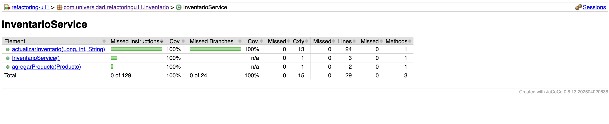
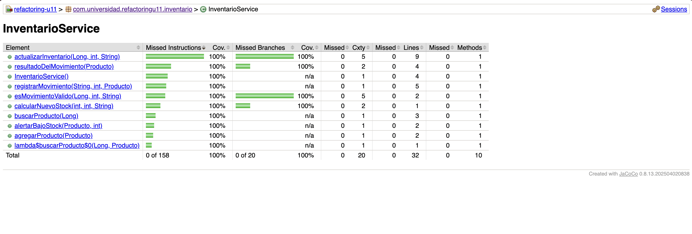
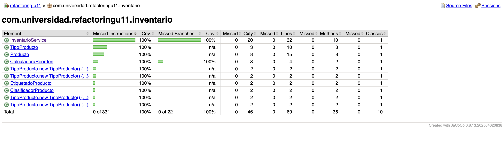

# Refactorización Guiada por Pruebas: Code Smells, Paquetes y Acoplamiento

**Post-contenido — Unidad 11 · Patrones de Diseño de Software**
Juan Sebastián Gamboa Cristancho · Universidad de Santander (UDES) · Cúcuta, 2026

Kata de refactorización sobre un servicio de inventario en Spring Boot. En la **Parte 1** se blindan con pruebas de caracterización dos code smells reales (un *Long Method* y un *Switch Statement* duplicado) y solo después se refactorizan, verificando con las mismas pruebas, sin modificarlas, que el comportamiento observable no cambia.

## Estructura del proyecto

```
gamboa-post1-u11/
├── pom.xml                                  ← Spring Boot 3.5.6, Java 17, JUnit 5, JaCoCo
├── docs/                                    ← capturas de JaCoCo (antes / después)
└── src/
    ├── main/java/com/universidad/refactoringu11/
    │   ├── RefactoringU11Application.java
    │   └── inventario/
    │       ├── Producto.java
    │       ├── TipoProducto.java            ← enum con comportamiento por tipo
    │       ├── InventarioService.java       ← actualizarInventario() descompuesto
    │       ├── CalculadoraReorden.java      ← política de reabastecimiento (extraída)
    │       ├── ClasificadorProducto.java    ← delega en TipoProducto
    │       └── EtiquetadoProducto.java      ← delega en TipoProducto
    └── test/java/com/universidad/refactoringu11/
        ├── RefactoringU11ApplicationTests.java
        └── inventario/                      ← pruebas de caracterización (sin modificar)
            ├── InventarioServiceTest.java   ← 13 pruebas
            ├── ClasificadorProductoTest.java← 4 pruebas
            └── EtiquetadoProductoTest.java  ← 4 pruebas
```

## Cómo ejecutar

```bash
./mvnw test                         # pruebas + reporte JaCoCo
open target/site/jacoco/index.html  # cobertura y complejidad ciclomática por método
```

---

# Parte 1 — Red de seguridad y refactorización guiada por evidencia

## Code smells encontrados en el código original

### Smell 1 — Long Method (Bloater) en `InventarioService.actualizarInventario()`

| Evidencia | Valor en el código original |
|-----------|-----------------------------|
| Líneas de código del método | **38** (24 líneas ejecutables según JaCoCo) |
| Complejidad ciclomática (JaCoCo, Cxty) | **13** |
| Responsabilidades mezcladas | **5**: validación de entrada, búsqueda del producto, actualización de stock, cálculo de reorden, registro del movimiento y alerta |
| Señales en el propio código | comentarios-encabezado de sección (`// Validacion de entrada`, `// Busqueda del producto`, …), un `for` con `break` y un `if` anidado dentro del `else` |

Cada comentario-encabezado marcaba una responsabilidad que pedía su propio nombre: Martin los clasifica como comentarios que compensan un método demasiado largo.

### Smell 2 — Switch Statements duplicados (OO-Abuser / Change Preventer)

| Evidencia | Código original |
|-----------|-----------------|
| Clases con `switch (producto.getTipo())` | **2**: `ClasificadorProducto.calcularRecargoEnvio()` y `EtiquetadoProducto.generarEtiqueta()` |
| Ramas `case` repetidas | **8** (las mismas 4 constantes en ambas clases) más 2 `default` |
| Costo de agregar un tipo nuevo | modificar **2 clases** y recordar hacerlo: *Shotgun Surgery* y violación de Open/Closed |

## Red de seguridad: pruebas de caracterización escritas ANTES de refactorizar

Las pruebas se escribieron y ejecutaron en verde sobre el código original, en un commit propio (`test: agregar pruebas de caracterizacion antes de refactorizar`), antes de modificar cualquier clase. Se instancian con `new`, sin levantar Spring, para que corran en milisegundos.

| Clase de prueba | Pruebas | Qué documenta |
|-----------------|---------|---------------|
| `InventarioServiceTest` | 13 | Los cuatro tipos de retorno (`OK_n`, `ERROR_DATOS_INVALIDOS`, `ERROR_STOCK_INSUFICIENTE`, `OK_BAJO_STOCK_REORDEN_n`) y `ERROR_PRODUCTO_NO_EXISTE`, más 7 casos límite: cantidad 0, id nulo, `"entrada"` en minúsculas, stock que queda **igual** al mínimo (no reordena: la condición es estricta), stock que queda en 0, ENTRADA que no alcanza el mínimo (también reordena) y ENTRADA con cantidad negativa (hoy **resta** stock: comportamiento discutible, documentado tal cual) |
| `ClasificadorProductoTest` | 4 | Las cuatro ramas del switch de recargo |
| `EtiquetadoProductoTest` | 4 | Las cuatro ramas del switch de etiqueta (el enunciado traía 2; se agregaron ROPA y ALIMENTO para cubrir los cuatro tipos) |
| `RefactoringU11ApplicationTests` | 1 | El contexto de Spring arranca |

**Cobertura de la red de seguridad sobre el código original:** 100 % de las ramas de `actualizarInventario()` (24/24), según JaCoCo. Cada camino del método quedó ejercitado antes de tocarlo.

**Las pruebas no se modificaron en ningún momento:** `git diff e65a0ca HEAD -- src/test` no muestra cambios.

## Resultado de `mvn test` en cada etapa

| Momento | Pruebas | Resultado |
|---------|---------|-----------|
| Código original (antes de refactorizar) | 22 | ✅ 22 en verde |
| Tras eliminar el Long Method | 22 | ✅ 22 en verde, sin modificar pruebas |
| Tras eliminar el switch duplicado | 22 | ✅ 22 en verde, sin modificar pruebas |

## Refactorización 1 — Long Method

**Técnicas aplicadas (Fowler):** *Extract Method* para cada responsabilidad, *Replace Nested Conditional with Guard Clauses* (retornos tempranos en lugar del `if` dentro del `else`), *Extract Class* para la política de reorden y *Replace Loop with Pipeline* en la búsqueda, que además devuelve `Optional` en lugar de `null`.

```java
public String actualizarInventario(Long productoId, int cantidad, String tipoMovimiento) {
    if (!esMovimientoValido(productoId, cantidad, tipoMovimiento)) return "ERROR_DATOS_INVALIDOS";
    Optional<Producto> encontrado = buscarProducto(productoId);
    if (encontrado.isEmpty()) return "ERROR_PRODUCTO_NO_EXISTE";
    Producto producto = encontrado.get();
    int nuevoStock = calcularNuevoStock(producto.getStock(), cantidad, tipoMovimiento);
    if (tipoMovimiento.equals(SALIDA) && nuevoStock < 0) return "ERROR_STOCK_INSUFICIENTE";
    producto.setStock(nuevoStock);
    registrarMovimiento(tipoMovimiento, cantidad, producto);
    return resultadoDelMovimiento(producto);
}
```

| Métrica de `actualizarInventario()` | Antes | Después |
|-------------------------------------|-------|---------|
| Líneas de código | 38 | **11** (cuerpo de 9) |
| Líneas ejecutables (JaCoCo) | 24 | **9** |
| Complejidad ciclomática | 13 | **5** |
| Complejidad máxima de cualquier método de la clase | 13 | **5** |
| Responsabilidades propias | 5 | **1** (orquestar el movimiento) |

| Método o clase extraída | Única responsabilidad |
|-------------------------|-----------------------|
| `esMovimientoValido()` | validar los datos de entrada |
| `buscarProducto()` | localizar el producto (`Optional`) |
| `calcularNuevoStock()` | aplicar la ENTRADA o la SALIDA |
| `registrarMovimiento()` | auditar el movimiento |
| `resultadoDelMovimiento()` | decidir el resultado según la política de reorden |
| `alertarBajoStock()` | emitir la alerta |
| `CalculadoraReorden` | política de reabastecimiento (stock objetivo = 3 × mínimo) |

**Comportamiento preservado a propósito.** Refactorizar no es corregir, así que se conservaron dos rasgos del original: el control de stock negativo sigue aplicando solo a `SALIDA` (una `ENTRADA` con cantidad muy negativa puede dejar stock negativo, igual que antes), y las comparaciones siguen siendo `tipoMovimiento.equals(...)`, de modo que un tipo `null` lanza la misma excepción. Ambos quedan como deuda técnica para un cambio de comportamiento explícito y con su propia prueba. Además de las 22 pruebas, la versión original y la refactorizada se compararon en 825 combinaciones de entrada (id nulo o inexistente, cantidades de −50 a 100, cinco tipos de movimiento y cinco situaciones de stock y mínimo) con resultado, stock final y salida de consola idénticos.

### Decisión de diseño 1 — Cálculo de reorden como clase colaboradora (`CalculadoraReorden`)

Se extrajo a una clase propia y no a un método privado porque tiene **una razón de cambio distinta** a la del servicio. `InventarioService` cambia cuando cambia la forma de registrar movimientos; la regla «reordenar hasta el triple del mínimo» es una **política de compras** que cambia por motivos de negocio ajenos al inventario (proveedor, tiempos de entrega, temporada). Separarla cumple el Principio de Responsabilidad Única, convierte el número mágico `3` en la constante con nombre `FACTOR_STOCK_OBJETIVO` y deja la política en un único lugar, lista para reutilizarse: la Parte 2 necesita la cantidad de reorden para notificar al módulo de reportes.

La clase expone un solo método, `OptionalInt cantidadAReordenar(Producto)`: vacío si no hace falta reordenar, o la cantidad si hace falta. Una primera versión tenía dos métodos (`necesitaReorden()` y `cantidadAReordenar()`) y JaCoCo mostró que la guarda interna del segundo nunca se ejecutaba (75 % de ramas): era código muerto por diseño. Unificarlos en un único método eliminó esa rama inalcanzable y el acoplamiento temporal entre las dos llamadas.

Se instancia dentro del servicio (`new CalculadoraReorden()`) y no se inyecta, porque las pruebas de caracterización construyen `InventarioService` con su constructor vacío y no debían modificarse. Si la política llegara a variar por configuración, el siguiente paso sería convertirla en un bean inyectado por constructor.

## Refactorización 2 — Switch Statements duplicados

**Técnica aplicada (Fowler):** *Replace Conditional with Polymorphism*, usando métodos específicos por constante del propio `enum`.

```java
public enum TipoProducto {
    LIBRO("[LIBRO]", "Exento de IVA") {
        @Override public double calcularRecargoEnvio(double precio) { return 0.0; }
    },
    ELECTRONICO("[ELECTRO]", "Garantia 1 ano") {
        @Override public double calcularRecargoEnvio(double precio) { return precio * 0.08; }
    },
    ROPA("[ROPA]", "Ver talla") {
        @Override public double calcularRecargoEnvio(double precio) { return precio * 0.03; }
    },
    ALIMENTO("[ALIMENTO]", "Perecedero") {
        @Override public double calcularRecargoEnvio(double precio) { return 2.50; }
    };

    public abstract double calcularRecargoEnvio(double precio);   // varía la fórmula
    public String generarEtiqueta(String nombreProducto) { ... }  // varían solo los datos
}
```

```java
// ClasificadorProducto — misma firma original
public double calcularRecargoEnvio(Producto producto) {
    return producto.getTipo().calcularRecargoEnvio(producto.getPrecio());
}
// EtiquetadoProducto — misma firma original
public String generarEtiqueta(Producto producto) {
    return producto.getTipo().generarEtiqueta(producto.getNombre());
}
```

| Evidencia | Antes | Después |
|-----------|-------|---------|
| `switch` sobre `TipoProducto` en `src/main` | 2 | **0** (`grep -rnE "switch\|case [A-Z]" src/main/java` no devuelve resultados) |
| Ramas `case` + `default` | 10 | **0** |
| Clases a modificar para agregar un tipo | 2 (y recordarlo) | **0**: solo se agrega la constante en `TipoProducto`, y el compilador exige definir su recargo y su etiqueta |
| Complejidad de `ClasificadorProducto` / `EtiquetadoProducto` (JaCoCo) | un `switch` de 4 casos + `default` en cada una | **2 / 2** (un método de una línea + constructor) |

**Matiz de diseño.** El recargo es comportamiento que varía (cada tipo tiene una fórmula distinta), por eso es un método abstracto que cada constante implementa. La etiqueta, en cambio, sigue la misma fórmula para todos los tipos y solo varían el prefijo y la leyenda; por eso son campos del `enum` y no un segundo método abstracto, que habría repetido la misma concatenación cuatro veces.

### Decisión de diseño 2 — Enum con comportamiento en lugar de interfaz Strategy

Se eligió el `enum` con métodos por constante porque **el conjunto de tipos es cerrado y estable** en este dominio: los cuatro tipos son parte del modelo, no extensiones de terceros. Con esta opción:

- El comportamiento vive junto al tipo que lo define, sin crear una jerarquía de cuatro clases adicionales ni un mecanismo de registro.
- El compilador garantiza la completitud: una constante nueva sin `calcularRecargoEnvio()` no compila, mientras que con el `switch` un tipo olvidado solo fallaba en tiempo de ejecución por el `default`.
- `ClasificadorProducto` y `EtiquetadoProducto` quedan cerradas a la modificación (Open/Closed).

**Costo aceptado:** un `enum` no puede recibir colaboradores inyectados por Spring. Si en el futuro el recargo de un tipo dependiera, por ejemplo, de un servicio de tarifas externo, convendría migrar a una interfaz `EstrategiaTipoProducto` con un bean por tipo indexado en un `Map`. Hoy ninguna regla lo requiere, así que esa jerarquía sería *Speculative Generality*.

## Capturas — Parte 1

**Antes:** `actualizarInventario()` con Cxty 13 y 100 % de ramas cubiertas por las pruebas de caracterización



**Después del Paso 3:** `actualizarInventario()` con Cxty 5 y métodos extraídos



**Después del Paso 4:** paquete `inventario`, con `ClasificadorProducto` y `EtiquetadoProducto` en Cxty 2



---

# Parte 2 — Diagnóstico y resolución de acoplamiento entre paquetes

*(En desarrollo.)*

## Herramientas utilizadas

- Java 17 (compilado con JDK 25), Spring Boot 3.5.6, Maven Wrapper
- JUnit 5, JaCoCo 0.8.13
- Git, GitHub
