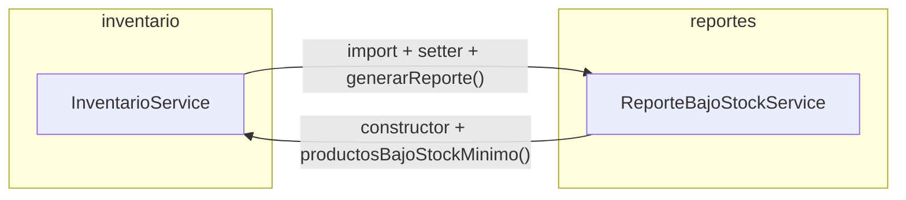
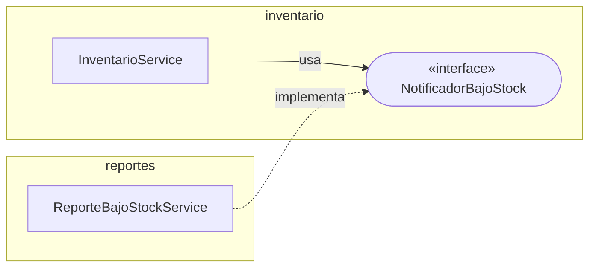

# Refactorización Guiada por Pruebas: Code Smells, Paquetes y Acoplamiento

**Post-contenido — Unidad 11 · Patrones de Diseño de Software**
Juan Sebastián Gamboa Cristancho · Universidad de Santander (UDES) · Cúcuta, 2026

Kata de refactorización sobre un servicio de inventario en Spring Boot. En la **Parte 1** se blindan con pruebas de caracterización dos code smells reales (un *Long Method* y un *Switch Statement* duplicado) y solo después se refactorizan, verificando con las mismas pruebas, sin modificarlas, que el comportamiento observable no cambia. En la **Parte 2** se agrega un módulo de reportes que introduce una dependencia cíclica entre paquetes; se diagnostica con una prueba de arquitectura (ArchUnit), se resuelve invirtiendo la dependencia y se confirma, con las mismas pruebas de la Parte 1, que el comportamiento sigue intacto.

## Resultado en una línea

| Smell | Antes | Después |
|-------|-------|---------|
| Long Method en `actualizarInventario()` | 38 líneas, CC 13, 5 responsabilidades | 11 líneas, CC 5, delega en 6 métodos y `CalculadoraReorden` |
| Switch duplicado sobre `TipoProducto` | 2 clases, 8 `case` + 2 `default` | 0: polimorfismo en el `enum` |
| Ciclo `inventario ↔ reportes` | ArchUnit en rojo y la aplicación no arranca (ciclo de beans) | ArchUnit en verde, dependencia solo `reportes → inventario` |
| Pruebas de caracterización (21) | escritas antes de refactorizar | **sin modificar** y en verde en el estado final (27/27 pruebas) |

## Estructura del proyecto

```
gamboa-post1-u11/
├── pom.xml                                  ← Spring Boot 3.5.6, Java 17, JUnit 5, JaCoCo
├── docs/                                    ← capturas de JaCoCo y salidas de pruebas (evidencias/)
└── src/
    ├── main/java/com/universidad/refactoringu11/
    │   ├── RefactoringU11Application.java
    │   ├── inventario/
    │   │   ├── NotificadorBajoStock.java    ← puerto (interfaz) para avisar bajo stock
    │   │   ├── Producto.java
    │   │   ├── TipoProducto.java            ← enum con comportamiento por tipo
    │   │   ├── InventarioService.java       ← actualizarInventario() descompuesto
    │   │   ├── CalculadoraReorden.java      ← política de reabastecimiento (extraída)
    │   │   ├── ClasificadorProducto.java    ← delega en TipoProducto
    │   │   └── EtiquetadoProducto.java      ← delega en TipoProducto
    │   └── reportes/
    │       └── ReporteBajoStockService.java ← implementa NotificadorBajoStock
    └── test/
        ├── resources/archunit.properties
        └── java/com/universidad/refactoringu11/
            ├── RefactoringU11ApplicationTests.java
            ├── ArquitecturaPaquetesTest.java    ← ArchUnit: paquetes libres de ciclos
            ├── inventario/
            │   ├── InventarioServiceTest.java   ← 13 pruebas de caracterización (sin modificar)
            │   ├── ClasificadorProductoTest.java← 4 pruebas de caracterización (sin modificar)
            │   ├── EtiquetadoProductoTest.java  ← 4 pruebas de caracterización (sin modificar)
            │   └── NotificacionBajoStockTest.java ← 2 pruebas del puerto (Parte 2)
            └── reportes/
                └── ReporteBajoStockServiceTest.java ← 2 pruebas del reporte (Parte 2)
```

## Cómo ejecutar

```bash
./mvnw test                                   # 27 pruebas + reporte JaCoCo
./mvnw test -Dtest=ArquitecturaPaquetesTest    # solo la prueba de arquitectura
open target/site/jacoco/index.html  # cobertura y complejidad ciclomática por método
```

---

# Parte 1 — Red de seguridad y refactorización guiada por evidencia

## Code smells encontrados en el código original

### Smell 1 — Long Method (Bloater) en `InventarioService.actualizarInventario()`

| Evidencia | Valor en el código original |
|-----------|-----------------------------|
| Líneas de código del método | **38** (24 líneas ejecutables según JaCoCo) |
| Complejidad ciclomática (JaCoCo, Cxty) | **13** |
| Responsabilidades mezcladas | **5**: validación de entrada, búsqueda del producto, actualización de stock, cálculo de reorden, registro del movimiento y alerta |
| Señales en el propio código | comentarios-encabezado de sección (`// Validacion de entrada`, `// Busqueda del producto`, …), un `for` con `break` y un `if` anidado dentro del `else` |

Cada comentario-encabezado marcaba una responsabilidad que pedía su propio nombre: Martin los clasifica como comentarios que compensan un método demasiado largo.

### Smell 2 — Switch Statements duplicados (OO-Abuser / Change Preventer)

| Evidencia | Código original |
|-----------|-----------------|
| Clases con `switch (producto.getTipo())` | **2**: `ClasificadorProducto.calcularRecargoEnvio()` y `EtiquetadoProducto.generarEtiqueta()` |
| Ramas `case` repetidas | **8** (las mismas 4 constantes en ambas clases) más 2 `default` |
| Costo de agregar un tipo nuevo | modificar **2 clases** y recordar hacerlo: *Shotgun Surgery* y violación de Open/Closed |

## Red de seguridad: pruebas de caracterización escritas ANTES de refactorizar

Las pruebas se escribieron y ejecutaron en verde sobre el código original, en un commit propio (`test: agregar pruebas de caracterizacion antes de refactorizar`), antes de modificar cualquier clase. Se instancian con `new`, sin levantar Spring, para que corran en milisegundos.

| Clase de prueba | Pruebas | Qué documenta |
|-----------------|---------|---------------|
| `InventarioServiceTest` | 13 | Los cuatro tipos de retorno (`OK_n`, `ERROR_DATOS_INVALIDOS`, `ERROR_STOCK_INSUFICIENTE`, `OK_BAJO_STOCK_REORDEN_n`) y `ERROR_PRODUCTO_NO_EXISTE`, más 7 casos límite: cantidad 0, id nulo, `"entrada"` en minúsculas, stock que queda **igual** al mínimo (no reordena: la condición es estricta), stock que queda en 0, ENTRADA que no alcanza el mínimo (también reordena) y ENTRADA con cantidad negativa (hoy **resta** stock: comportamiento discutible, documentado tal cual) |
| `ClasificadorProductoTest` | 4 | Las cuatro ramas del switch de recargo |
| `EtiquetadoProductoTest` | 4 | Las cuatro ramas del switch de etiqueta (el enunciado traía 2; se agregaron ROPA y ALIMENTO para cubrir los cuatro tipos) |
| `RefactoringU11ApplicationTests` | 1 | El contexto de Spring arranca |

**Cobertura de la red de seguridad sobre el código original:** 100 % de las ramas de `actualizarInventario()` (24/24), según JaCoCo. Cada camino del método quedó ejercitado antes de tocarlo.

**Las pruebas no se modificaron en ningún momento:** `git diff e65a0ca HEAD` sobre `InventarioServiceTest`, `ClasificadorProductoTest` y `EtiquetadoProductoTest` no muestra cambios, ni al cierre de la Parte 1 ni en el estado final del repositorio.

## Resultado de `mvn test` en cada etapa

| Momento | Pruebas | Resultado |
|---------|---------|-----------|
| Código original (antes de refactorizar) | 22 | ✅ 22 en verde |
| Tras eliminar el Long Method | 22 | ✅ 22 en verde, sin modificar pruebas |
| Tras eliminar el switch duplicado | 22 | ✅ 22 en verde, sin modificar pruebas |

## Refactorización 1 — Long Method

**Técnicas aplicadas (Fowler):** *Extract Method* para cada responsabilidad, *Replace Nested Conditional with Guard Clauses* (retornos tempranos en lugar del `if` dentro del `else`), *Extract Class* para la política de reorden y *Replace Loop with Pipeline* en la búsqueda, que además devuelve `Optional` en lugar de `null`.

```java
public String actualizarInventario(Long productoId, int cantidad, String tipoMovimiento) {
    if (!esMovimientoValido(productoId, cantidad, tipoMovimiento)) return "ERROR_DATOS_INVALIDOS";
    Optional<Producto> encontrado = buscarProducto(productoId);
    if (encontrado.isEmpty()) return "ERROR_PRODUCTO_NO_EXISTE";
    Producto producto = encontrado.get();
    int nuevoStock = calcularNuevoStock(producto.getStock(), cantidad, tipoMovimiento);
    if (tipoMovimiento.equals(SALIDA) && nuevoStock < 0) return "ERROR_STOCK_INSUFICIENTE";
    producto.setStock(nuevoStock);
    registrarMovimiento(tipoMovimiento, cantidad, producto);
    return resultadoDelMovimiento(producto);
}
```

| Métrica de `actualizarInventario()` | Antes | Después |
|-------------------------------------|-------|---------|
| Líneas de código | 38 | **11** (cuerpo de 9) |
| Líneas ejecutables (JaCoCo) | 24 | **9** |
| Complejidad ciclomática | 13 | **5** |
| Complejidad máxima de cualquier método de la clase | 13 | **5** |
| Responsabilidades propias | 5 | **1** (orquestar el movimiento) |

| Método o clase extraída | Única responsabilidad |
|-------------------------|-----------------------|
| `esMovimientoValido()` | validar los datos de entrada |
| `buscarProducto()` | localizar el producto (`Optional`) |
| `calcularNuevoStock()` | aplicar la ENTRADA o la SALIDA |
| `registrarMovimiento()` | auditar el movimiento |
| `resultadoDelMovimiento()` | decidir el resultado según la política de reorden |
| `alertarBajoStock()` | emitir la alerta |
| `CalculadoraReorden` | política de reabastecimiento (stock objetivo = 3 × mínimo) |

**Comportamiento preservado a propósito.** Refactorizar no es corregir, así que se conservaron dos rasgos del original: el control de stock negativo sigue aplicando solo a `SALIDA` (una `ENTRADA` con cantidad muy negativa puede dejar stock negativo, igual que antes), y las comparaciones siguen siendo `tipoMovimiento.equals(...)`, de modo que un tipo `null` lanza la misma excepción. Ambos quedan como deuda técnica para un cambio de comportamiento explícito y con su propia prueba. Además de las 22 pruebas, la versión original y la refactorizada se compararon en 825 combinaciones de entrada (id nulo o inexistente, cantidades de −50 a 100, cinco tipos de movimiento y cinco situaciones de stock y mínimo) con resultado, stock final y salida de consola idénticos.

### Decisión de diseño 1 — Cálculo de reorden como clase colaboradora (`CalculadoraReorden`)

Se extrajo a una clase propia y no a un método privado porque tiene **una razón de cambio distinta** a la del servicio. `InventarioService` cambia cuando cambia la forma de registrar movimientos; la regla «reordenar hasta el triple del mínimo» es una **política de compras** que cambia por motivos de negocio ajenos al inventario (proveedor, tiempos de entrega, temporada). Separarla cumple el Principio de Responsabilidad Única, convierte el número mágico `3` en la constante con nombre `FACTOR_STOCK_OBJETIVO` y deja la política en un único lugar, lista para reutilizarse: la Parte 2 necesita la cantidad de reorden para notificar al módulo de reportes.

La clase expone un solo método, `OptionalInt cantidadAReordenar(Producto)`: vacío si no hace falta reordenar, o la cantidad si hace falta. Una primera versión tenía dos métodos (`necesitaReorden()` y `cantidadAReordenar()`) y JaCoCo mostró que la guarda interna del segundo nunca se ejecutaba (75 % de ramas): era código muerto por diseño. Unificarlos en un único método eliminó esa rama inalcanzable y el acoplamiento temporal entre las dos llamadas.

Se instancia dentro del servicio (`new CalculadoraReorden()`) y no se inyecta, porque las pruebas de caracterización construyen `InventarioService` con su constructor vacío y no debían modificarse. Si la política llegara a variar por configuración, el siguiente paso sería convertirla en un bean inyectado por constructor.

## Refactorización 2 — Switch Statements duplicados

**Técnica aplicada (Fowler):** *Replace Conditional with Polymorphism*, usando métodos específicos por constante del propio `enum`.

```java
public enum TipoProducto {
    LIBRO("[LIBRO]", "Exento de IVA") {
        @Override public double calcularRecargoEnvio(double precio) { return 0.0; }
    },
    ELECTRONICO("[ELECTRO]", "Garantia 1 ano") {
        @Override public double calcularRecargoEnvio(double precio) { return precio * 0.08; }
    },
    ROPA("[ROPA]", "Ver talla") {
        @Override public double calcularRecargoEnvio(double precio) { return precio * 0.03; }
    },
    ALIMENTO("[ALIMENTO]", "Perecedero") {
        @Override public double calcularRecargoEnvio(double precio) { return 2.50; }
    };

    public abstract double calcularRecargoEnvio(double precio);   // varía la fórmula
    public String generarEtiqueta(String nombreProducto) { ... }  // varían solo los datos
}
```

```java
// ClasificadorProducto — misma firma original
public double calcularRecargoEnvio(Producto producto) {
    return producto.getTipo().calcularRecargoEnvio(producto.getPrecio());
}
// EtiquetadoProducto — misma firma original
public String generarEtiqueta(Producto producto) {
    return producto.getTipo().generarEtiqueta(producto.getNombre());
}
```

| Evidencia | Antes | Después |
|-----------|-------|---------|
| `switch` sobre `TipoProducto` en `src/main` | 2 | **0** (`grep -rnE "switch\|case [A-Z]" src/main/java` no devuelve resultados) |
| Ramas `case` + `default` | 10 | **0** |
| Clases a modificar para agregar un tipo | 2 (y recordarlo) | **0**: solo se agrega la constante en `TipoProducto`, y el compilador exige definir su recargo y su etiqueta |
| Complejidad de `ClasificadorProducto` / `EtiquetadoProducto` (JaCoCo) | un `switch` de 4 casos + `default` en cada una | **2 / 2** (un método de una línea + constructor) |

**Matiz de diseño.** El recargo es comportamiento que varía (cada tipo tiene una fórmula distinta), por eso es un método abstracto que cada constante implementa. La etiqueta, en cambio, sigue la misma fórmula para todos los tipos y solo varían el prefijo y la leyenda; por eso son campos del `enum` y no un segundo método abstracto, que habría repetido la misma concatenación cuatro veces.

### Decisión de diseño 2 — Enum con comportamiento en lugar de interfaz Strategy

Se eligió el `enum` con métodos por constante porque **el conjunto de tipos es cerrado y estable** en este dominio: los cuatro tipos son parte del modelo, no extensiones de terceros. Con esta opción:

- El comportamiento vive junto al tipo que lo define, sin crear una jerarquía de cuatro clases adicionales ni un mecanismo de registro.
- El compilador garantiza la completitud: una constante nueva sin `calcularRecargoEnvio()` no compila, mientras que con el `switch` un tipo olvidado solo fallaba en tiempo de ejecución por el `default`.
- `ClasificadorProducto` y `EtiquetadoProducto` quedan cerradas a la modificación (Open/Closed).

**Costo aceptado:** un `enum` no puede recibir colaboradores inyectados por Spring. Si en el futuro el recargo de un tipo dependiera, por ejemplo, de un servicio de tarifas externo, convendría migrar a una interfaz `EstrategiaTipoProducto` con un bean por tipo indexado en un `Map`. Hoy ninguna regla lo requiere, así que esa jerarquía sería *Speculative Generality*.

## Capturas — Parte 1

**Antes:** `actualizarInventario()` con Cxty 13 y 100 % de ramas cubiertas por las pruebas de caracterización


**Después del Paso 3:** `actualizarInventario()` con Cxty 5 y métodos extraídos


**Después del Paso 4:** paquete `inventario`, con `ClasificadorProducto` y `EtiquetadoProducto` en Cxty 2


---

# Parte 2 — Diagnóstico y resolución de acoplamiento entre paquetes

Se agregó un paquete `reportes` con `ReporteBajoStockService`, que genera un reporte de los productos bajo el stock mínimo consultando a `InventarioService`. Para que el inventario avise al reporte cuando detecta bajo stock, `InventarioService` recibe `ReporteBajoStockService` por setter (`@Autowired(required = false)`) y lo invoca en la rama de alerta.

## Diagnóstico: el ciclo entre `inventario` y `reportes`

El proyecto compila y las 21 pruebas de caracterización siguen en verde, porque construyen `InventarioService` con `new` y el reporte queda en `null`. El problema no es de comportamiento sino de arquitectura: los dos paquetes dependen uno del otro.



```
   ┌──────────────┐  importa ReporteBajoStockService   ┌──────────────┐
   │  inventario  │ ─────────────────────────────────▶ │   reportes   │
   │              │ ◀───────────────────────────────── │              │
   └──────────────┘  importa InventarioService          └──────────────┘
                       → CICLO: inventario → reportes → inventario
```

### Evidencia 1 — `ArquitecturaPaquetesTest` en rojo

La prueba de arquitectura (`slices().matching("com.universidad.refactoringu11.(*)..").should().beFreeOfCycles()`) falla y ArchUnit enumera cada dependencia que forma el ciclo:

```
[ERROR] Tests run: 1, Failures: 1, Errors: 0, Skipped: 0 <<< FAILURE! -- in com.universidad.refactoringu11.ArquitecturaPaquetesTest

Architecture Violation [Priority: MEDIUM] - Rule 'slices matching 'com.universidad.refactoringu11.(*)..' should be free of cycles' was violated (1 times):
Cycle detected: Slice inventario ->
                Slice reportes ->
                Slice inventario
  1. Dependencies of Slice inventario
    - Field <...inventario.InventarioService.reporteBajoStockService> has type <...reportes.ReporteBajoStockService>
    - Method <...inventario.InventarioService.setReporteBajoStockService(...reportes.ReporteBajoStockService)> has parameter of type <...reportes.ReporteBajoStockService>
    - Method <...inventario.InventarioService.alertarBajoStock(...)> calls method <...reportes.ReporteBajoStockService.generarReporte()>
  2. Dependencies of Slice reportes
    - Constructor <...reportes.ReporteBajoStockService.<init>(...inventario.InventarioService)> has parameter of type <...inventario.InventarioService>
    - Field <...reportes.ReporteBajoStockService.inventarioService> has type <...inventario.InventarioService>
    - Method <...reportes.ReporteBajoStockService.generarReporte()> calls method <...inventario.InventarioService.productosBajoStockMinimo()>
    - Method <...reportes.ReporteBajoStockService.generarReporte()> calls method <...inventario.Producto.getNombre()> (y getStock(), getStockMinimo())
```

Salida completa en [`docs/evidencias/archunit-ciclo-rojo.txt`](docs/evidencias/archunit-ciclo-rojo.txt).

### Evidencia 2 — el ciclo también existe en tiempo de ejecución

El enunciado describe el ciclo como un problema que «no rompe ninguna prueba». Eso es cierto para las pruebas de negocio, pero no para la aplicación: desde Spring Boot 2.6 las referencias circulares entre beans están prohibidas por defecto, y la prueba `contextLoads` generada por Spring Initializr falló con la aplicación incapaz de arrancar:

```
[ERROR] Tests run: 22, Failures: 0, Errors: 1, Skipped: 0

APPLICATION FAILED TO START

The dependencies of some of the beans in the application context form a cycle:
┌─────┐
|  inventarioService
↑     ↓
|  reporteBajoStockService
└─────┘
```

Salida completa en [`docs/evidencias/ciclo-beans-spring.txt`](docs/evidencias/ciclo-beans-spring.txt). Spring sugiere como «último recurso» `spring.main.allow-circular-references=true`; se descartó porque oculta el síntoma sin corregir el diseño, del mismo modo que el `!= null` del setter oculta el colaborador en las pruebas.

| Prueba | Estado con el ciclo |
|--------|---------------------|
| `InventarioServiceTest` (13), `ClasificadorProductoTest` (4), `EtiquetadoProductoTest` (4) | ✅ 21 en verde |
| `ArquitecturaPaquetesTest` | ❌ ciclo `inventario → reportes → inventario` |
| `RefactoringU11ApplicationTests.contextLoads` | ❌ ciclo de beans `inventarioService ↔ reporteBajoStockService` |

## Resolución: inversión de dependencias con `NotificadorBajoStock`

Se aplicó el Principio de Inversión de Dependencias: el paquete de mayor nivel (`inventario`) deja de depender del de menor nivel (`reportes`) y ambos pasan a depender de una abstracción que vive junto al de mayor nivel.

```java
// inventario/NotificadorBajoStock.java — el puerto lo define el dominio
@FunctionalInterface
public interface NotificadorBajoStock {
    void notificar(Producto producto, int cantidadReorden);
}
```

```java
// inventario/InventarioService.java — ya no importa ninguna clase de reportes
private NotificadorBajoStock notificador; // depende de la abstraccion, no de reportes

@Autowired(required = false)
public void setNotificador(NotificadorBajoStock notificador) { this.notificador = notificador; }

private void alertarBajoStock(Producto producto, int cantidadReorden) {
    if (notificador != null) {
        notificador.notificar(producto, cantidadReorden);
    }
    System.out.println("ALERTA: " + producto.getNombre() + " bajo stock minimo. Reordenar " + cantidadReorden + " unidades.");
}
```

```java
// reportes/ReporteBajoStockService.java — implementa el puerto: reportes -> inventario
@Service
public class ReporteBajoStockService implements NotificadorBajoStock {
    private final Map<Long, String> alertasPorProducto = new LinkedHashMap<>();

    @Override
    public void notificar(Producto producto, int cantidadReorden) { /* registra la alerta */ }

    public String generarReporte() { /* arma el reporte con las alertas registradas */ }
}
```

**Ajuste respecto al enunciado: el reporte ya no recibe `InventarioService`.** El enunciado conserva el constructor `ReporteBajoStockService(InventarioService)`. Con ese constructor, el ciclo de **paquetes** desaparece, pero el ciclo de **beans** persiste: `InventarioService` necesita un `NotificadorBajoStock` (que es `ReporteBajoStockService`), y este necesitaría a `InventarioService`, así que `contextLoads` seguiría fallando. Por eso el reporte se construye a partir de las notificaciones que recibe, sin volver a consultar al inventario. El método `productosBajoStockMinimo()`, agregado en el Paso 1 solo para el reporte, quedó sin uso y se eliminó para no dejar código muerto.

### Diagrama de paquetes — después



```
   ┌──────────────────────────────────────────┐
   │ inventario                               │
   │   InventarioService ──usa──▶ «interface» │      ┌──────────────────────────┐
   │                        NotificadorBajoStock ◀───│ reportes                 │
   └──────────────────────────────────────────┘ impl │   ReporteBajoStockService│
                                                     └──────────────────────────┘
                 Una sola dirección: reportes → inventario (sin ciclo)
```

| Dependencia | Antes | Después |
|-------------|-------|---------|
| `inventario → reportes` | 3 (campo, setter, llamada a `generarReporte()`) | **0** (`grep -rn "refactoringu11.reportes" src/main/java/.../inventario` no devuelve resultados) |
| `reportes → inventario` | 6 (constructor, campo, `productosBajoStockMinimo()`, 3 getters de `Producto`) | solo `NotificadorBajoStock` y `Producto` |
| Ciclo de beans de Spring | `inventarioService ↔ reporteBajoStockService` | ninguno: `ReporteBajoStockService` no tiene dependencias |

### Evidencia — `ArquitecturaPaquetesTest` en verde

```
$ ./mvnw test -Dtest=ArquitecturaPaquetesTest
[INFO] Running com.universidad.refactoringu11.ArquitecturaPaquetesTest
[INFO] Tests run: 1, Failures: 0, Errors: 0, Skipped: 0
[INFO] BUILD SUCCESS
```

## Confirmación: las pruebas de la Parte 1 siguen en verde sin modificarse

```
$ ./mvnw test
[INFO] Running com.universidad.refactoringu11.reportes.ReporteBajoStockServiceTest   Tests run: 2,  Failures: 0
[INFO] Running com.universidad.refactoringu11.RefactoringU11ApplicationTests         Tests run: 1,  Failures: 0
[INFO] Running com.universidad.refactoringu11.ArquitecturaPaquetesTest               Tests run: 1,  Failures: 0
[INFO] Running com.universidad.refactoringu11.inventario.ClasificadorProductoTest    Tests run: 4,  Failures: 0
[INFO] Running com.universidad.refactoringu11.inventario.EtiquetadoProductoTest      Tests run: 4,  Failures: 0
[INFO] Running com.universidad.refactoringu11.inventario.InventarioServiceTest       Tests run: 13, Failures: 0
[INFO] Running com.universidad.refactoringu11.inventario.NotificacionBajoStockTest   Tests run: 2,  Failures: 0
[INFO] Tests run: 27, Failures: 0, Errors: 0, Skipped: 0
[INFO] BUILD SUCCESS
```

```
$ git diff e65a0ca HEAD --stat -- src/test/java/com/universidad/refactoringu11/inventario/InventarioServiceTest.java \
      src/test/java/com/universidad/refactoringu11/inventario/ClasificadorProductoTest.java \
      src/test/java/com/universidad/refactoringu11/inventario/EtiquetadoProductoTest.java
(sin salida: los tres archivos son idénticos a como se escribieron en el Paso 2 de la Parte 1)
```

| Prueba | Con el ciclo | Después de invertir la dependencia |
|--------|--------------|------------------------------------|
| 21 pruebas de caracterización de la Parte 1 | ✅ verdes | ✅ verdes, sin modificar |
| `ArquitecturaPaquetesTest` | ❌ ciclo detectado | ✅ verde |
| `RefactoringU11ApplicationTests.contextLoads` | ❌ ciclo de beans | ✅ verde |
| `NotificacionBajoStockTest` (2, nueva) | — | ✅ el inventario avisa por el puerto con la cantidad correcta y no avisa si el stock queda en el mínimo; usa una lambda como doble de prueba, sin Spring ni el paquete `reportes` |
| `ReporteBajoStockServiceTest` (2, nueva) | — | ✅ reporte vacío y última alerta por producto en orden de llegada |
| **Total** | 22 verdes, 2 en rojo | **27 de 27 en verde** |

## Decisiones de diseño — Parte 2

### Decisión de diseño 3 — `NotificadorBajoStock` vive en `inventario`, no en `reportes`

La Guía de Contenido (sección 4.3) establece que «los paquetes de infraestructura dependen de dominio; dominio nunca depende de infraestructura». En este proyecto **`inventario` es el paquete de mayor nivel**: contiene el modelo y las reglas de negocio (`Producto`, `TipoProducto`, la política de reorden) y es estable, porque varios módulos pueden reaccionar a él. **`reportes` es de menor nivel**: es una forma particular de presentar información derivada del inventario y podría reemplazarse por un correo, un mensaje a una cola o un tablero sin que cambie ninguna regla de inventario.

La interfaz expresa una necesidad del dominio («avisar que un producto quedó bajo el mínimo»), no un detalle de los reportes, así que pertenece a quien la necesita. Si se ubicara en `reportes`, `InventarioService` tendría que importarla desde ese paquete y la dependencia `inventario → reportes` seguiría existiendo: el ciclo no se rompería, solo cambiaría de clase. Ubicada en `inventario`, la flecha queda en una sola dirección, `reportes → inventario`, y el dominio no sabe cuántos ni cuáles notificadores existen.

### Decisión de diseño 4 — Notificación por evento individual

Se eligió `notificar(Producto producto, int cantidadReorden)`, un aviso por cada movimiento que deja un producto bajo el mínimo, en lugar de una notificación por lote como `notificar(List<Producto>)`:

- **Coincide con el momento en que ocurre el hecho.** `actualizarInventario()` procesa un movimiento a la vez, así que el evento natural es individual: el inventario no necesita acumular productos ni decidir cuándo vaciar un lote, lo que habría agregado estado y una nueva responsabilidad a la clase que se acaba de simplificar en la Parte 1.
- **Lleva el dato que solo el inventario conoce.** La `cantidadReorden` ya la calculó `CalculadoraReorden`; enviarla en el evento evita que `reportes` tenga que recalcularla, y con ello duplicar la política, o consultar de vuelta a `InventarioService`, que reintroduciría la dependencia y el ciclo de beans.
- **Permite reaccionar de inmediato y simplifica las pruebas:** `NotificacionBajoStockTest` verifica el contrato con una lambda de una línea.

**Cuándo convendría una notificación por lote:** si el inventario procesara cargas masivas, por ejemplo una importación de miles de movimientos o un cierre nocturno de existencias, o si el notificador fuera costoso por llamada (un correo, una API externa con límite de peticiones). En ese escenario un lote evita cientos de avisos individuales. Agregar ese método al puerto sería una extensión compatible, porque los notificadores actuales seguirían funcionando por evento.

## Herramientas utilizadas

- Java 17 (compilado con JDK 25), Spring Boot 3.5.6, Maven Wrapper
- JUnit 5, JaCoCo 0.8.13, ArchUnit 1.3.0
- Git, GitHub
